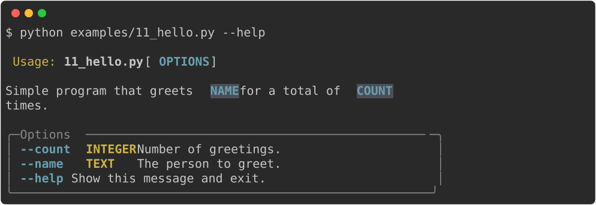

import { Image } from 'astro:assets';
import { TabItem, Tabs } from '@astrojs/starlight/components';
import homepage from '../images/blog/new-website/homepage.png';

Today we launched a new website for `rich-click` 🎉
It is built with [Astro Starlight](https://starlight.astro.build/) instead of MkDocs.
It's beautiful, fast and modern.

The site took a little time due to several detours, notably updates to [rich-codex](https://github.com/ewels/rich-codex) and the creation of two new Starlight plugins: [Starlight Pydocs](https://ewels.github.io/starlight-pydocs/) and [Starlight Codeblocks](https://ewels.github.io/starlight-codeblocks/).
In this blog post I dive into what changed, and why.

{/* excerpt */}

The main changes that you'll be able to see in the new site are:

- A redesigned homepage which is hopefully more interesting to look at and that does a better job at conveying what `rich-click` does.
- A new [Quickstart](../../documentation/quickstart/) page.
- Terminal output is now text, not screenshots. You can select it, search it and copy it, and it follows the light or dark theme.
- An auto-generated [API reference](../../api/rich_click/), generated from the `rich_click` source. A badge on each object tells you which release added it.
- Names in code examples link to the Click, Rich and Typer docs, with a card that opens when you hover.
- Every page is also served as Markdown, and the site publishes `llms.txt`. You can give the docs to an AI assistant with one click.

<figure>
  <Image
    src={homepage}
    alt="The new rich-click homepage: the logo and tagline on the left, and a terminal on the right showing rich-click help text, with buttons to switch colour scheme and format."
  />
  <figcaption>
    The new homepage. Pick a colour scheme and a format, and the terminal on the right updates. Psst: try clicking the
    logo.
  </figcaption>
</figure>

## Why move off MkDocs

[MkDocs](https://www.mkdocs.org/) has had no maintainer since August 2024.
Its planned v2 drops support for existing themes, plugins and config files.
[Material for MkDocs](https://squidfunk.github.io/mkdocs-material/), the theme we used, reaches [end of life](https://squidfunk.github.io/mkdocs-material/blog/2026/02/18/mkdocs-2.0/) on 5 November 2026.

In August I moved the rich-click website to build using [ProperDocs](https://properdocs.org/), a fork of MkDocs 1.x, in PR [`#341`](https://github.com/ewels/rich-click/pull/341).
That kept the site building, but only really as a stopgap.
[Zensical](https://zensical.org/) is the official successor to Material for MkDocs, but it's still at a fairly early stage of development and is missing functionality such as supporting blogs, our RSS feeds or custom plugins.

I have been a big fan of [Astro](https://astro.build/) for a while now, including its official documentation theme, [Starlight](https://starlight.astro.build/).
It's fast and modern, with good developer tooling.
It looks good out of the box and has a lot of clever tricks with how it bundles outputs, resulting in exceptionally [eco-friendly](https://starlight.astro.build/environmental-impact/) websites: a first visit to a Starlight page typically downloads less than 50 KB of compressed data, about 2.5% of the median web page.

On the same day as PR `#341`, I asked Claude to rebuild the whole site using Astro Starlight, with the same URLs, styles and features.
The first build was pretty decent:

- Every page, blog post, redirect and old feed URL still resolved.
- Versioned deploys kept the `gh-pages` methodology that [`mike`](https://github.com/jimporter/mike) used. The 1.8 docs, built with MkDocs, stay as they are and stay in the version picker.
- A full build only takes about 15 seconds.

I opened the result as a proof of concept in [#342](https://github.com/ewels/rich-click/pull/342) and asked my `rich-click` co-maintainer [Daniel Reeves](https://github.com/dwreeves) for his thoughts, with no plan to merge it soon.
He liked it, but had a few suggestions..

## starlight-pydocs: API docs from docstrings

Daniel had wanted API docs for a long time - we'd discussed it previously but never got around to putting the time in to figure them out.
On MkDocs the obvious tool is [mkdocstrings](https://mkdocstrings.github.io/), but there was no Astro / Starlight equivalent.
To make matters worse, whilst MkDocs is built in Python, Astro / Starlight are NodeJS projects, requiring a totally different tool chain.
However, there was a glimpse of hope: in [his review](https://github.com/ewels/rich-click/pull/342#issuecomment-5247648331) he pointed out that mkdocstrings keeps its Python parsing in a separate library, [Griffe](https://mkdocstrings.github.io/griffe/).
He suggested that a general Starlight plugin on top of Griffe could be a good open source project.
I was well and truly nerd-sniped 🎯

Four days later I published [starlight-pydocs](https://ewels.github.io/starlight-pydocs/) 0.1.0, and the `rich-click` branch had an API reference.
Like the site itself, I built it with Claude Code.
Claude first read how other Starlight plugins work, such as [starlight-openapi](https://starlight-openapi.vercel.app/) and [starlight-typedoc](https://starlight-typedoc.vercel.app/).
It wrote a plan from that, and then built the plugin step by step.

The plugin runs Griffe either as a prerequisite step, or as a subprocess during the website build.
Griffe reads the source by static analysis, so nothing is imported and your package does not need to be installed.
You only need `uv` on your path.
The plugin takes the Griffe output JSON and uses it to render one page per module, with a sidebar tree that follows the package layout.
It reads Google, NumPy and Sphinx docstrings, and it renders their prose with your site's own Markdown pipeline.

Two pretty neat features are _type links_ and _version badges_.
For type links, the plugin reads Sphinx inventories, so `click.Command` in a rich-click signature links to the Click docs.
For version badges you give the plugin a list of git refs, and it extracts the API at each ref and badges every object with the release that added it.
The plugin also publishes an `objects.inv` and an `llms.txt` for each package, so other sites and AI tools can link to your API.
It is on the [Starlight plugins list](https://starlight.astro.build/resources/plugins/), and it also works on Astro sites that do not use Starlight.

## starlight-codeblocks: code blocks that do more

Starlight renders code blocks with [Expressive Code](https://expressive-code.com/).
It gives you titles, line highlights and diff markers.
But now that I'd written one Starlight plugin, I started to dream about what else I could build.
Code examples are the heart of any documentation site, and I started thinking about all the cool things I've seen across my favourite websites over the years: notes on lines, links from code to API docs, and output under a command.

And so, [starlight-codeblocks](https://ewels.github.io/starlight-codeblocks/) started as a separate project in late September.
This time I wrote a design pack before any code: a spec for 24 features, with HTML mockups that showed how each one should look and behave.
I gave the pack to Claude with a kick-off prompt that said to work through the plan without stopping to ask questions.
Version 1.0.0 came out on 5 October, and the plugin now has 27 distinct features.
It builds on Expressive Code, so the code blocks you already have keep working.

This plugin also handles API auto-linking.
Names in any Python code blocks link to their docs, with a hover card.
The plugin uses the same Sphinx inventories as Starlight Pydocs, so now all free-form code blocks in the docs also link to their API docs.
It also has features for annotations (see the new [Quickstart](../../documentation/quickstart/) page) and some cool tricks up its sleeve such as being able to use WebAssembly to run Python code in the browser for examples.

When both plugins are installed, they find each other with no configuration.
The generated API pages get the hover cards, and long docstring examples collapse.

## rich-codex: terminal output as text

The final piece in the puzzle was [rich-codex](https://github.com/ewels/rich-codex).
It's a project I wrote a while back which finds commands in your Markdown, runs them, and saves the terminal output as an image.
It has made the terminal screenshots for rich-click since 2022.
A GitHub Action runs it on every push, so the screenshots stay in step with the code.

It had three releases to support the new rich-click website build as I went along:

1. MDX support. Starlight pages that use tabs or other components are MDX, and MDX does not allow HTML comments. Since August, rich-codex also reads its config from JSX comments: `{/* RICH-CODEX ... */}`.
2. Embedded fonts. An SVG inside an `` tag cannot load a web font. If you did not have Fira Code installed, the box lines of a rich-click panel came apart. A user had actually reported this in [rich-codex #65](https://github.com/ewels/rich-codex/issues/65), and this was the nudge I needed to solve it. Since rich-codex version 1.4.0 in September each SVG carries a subset of Fira Code.
3. Output as text. Now that I had Starlight Codeblocks working so well with WebAssembly output, it seemed strange to be embedding SVGs everywhere. I didn't want to run hundreds of examples in the browser, so instead as of version 1.5.0 (released today), rich-codex can save output as an `.ansi` file instead of an image: plain text with the ANSI colour codes kept.

The third change was a fun one.
It required changes across rich-codex, Starlight Codeblocks and the rich-click docs, all in unison.
The rich-click docs now have examples in their markdown files that look like this:

````mdx
{/* RICH-CODEX working_dir: docs/code_snippets/introduction_to_click */}
```sh runnable.outputFile="../images/code_snippets/introduction_to_click/hello_help.ansi"
$ python hello.py --help
```
````

rich-codex reads the comment, runs `python hello.py --help`, and writes the coloured output to the `.ansi` file.
Starlight Codeblocks then reads that file at build time and shows the output under the command.
It converts the ANSI codes to colours based on the site theme, and adjusts any colour that has less than `4.5:1` contrast against the output background.

Here is the example from our README, as the new text output and as the old SVG screenshot:

<Tabs>
<TabItem label="New: text output">

{/* RICH-CODEX working_dir: . */}
```sh runnable.outputFile="../images/blog/new-website/hello.ansi"
$ python examples/11_hello.py --help
```

</TabItem>
<TabItem label="Old: SVG screenshot">



</TabItem>
</Tabs>

The rich-click site now has 96 of these `.ansi` files in place of SVG screenshots - hopefully you'll agree they look great, and should be quite a bit easier to maintain.

## Use them on your own site

I finally merged the site rewrite PR today, three months after I opened it as an experiment.
Thanks to Daniel for the review, and for the idea that became Starlight Pydocs.

None of the three tools mentioned is specific to rich-click:

- [starlight-pydocs](https://ewels.github.io/starlight-pydocs/) works for any Python package. Install it with `npm install starlight-pydocs`.
- [starlight-codeblocks](https://ewels.github.io/starlight-codeblocks/) works on any Starlight or Astro site. Install it with `npm install starlight-codeblocks`.
- [rich-codex](https://github.com/ewels/rich-codex) runs as a GitHub Action or from the command line, and its `.ansi` output works with any tool that reads ANSI colour codes.

Both the Starlight plugins ship an agent skill, so you can ask your coding agent to set them up.

I hope you like how the new site looks, and perhaps find the tools that spun off to be useful.
If something breaks, or if you want a feature, please open an issue on GitHub.
